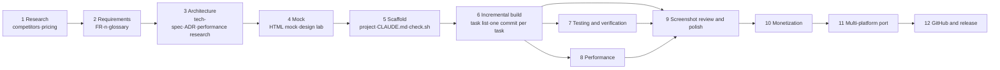

# 00 · Overview: from idea to store-ready

The process has 12 stages. Stages 1 through 5 produce only documents and mocks, never product code; from stage 6 on, every task lands as one commit. Each stage has a **gate**: if an output is missing or a check fails, you don't move on.



In practice, stages 6–10 form a loop: build a batch of tasks, take milestone screenshots, review them for P0/P1 issues, and add the fixes to the task list. Stage 11 (the other platform) can start any time after the first platform stabilizes. It repeats stages 2–9 but reuses the requirements as is.

## Stages, outputs and gates

| # | Stage | Outputs (in `doc/`) | Gate | Details |
|---|---|---|---|---|
| 1 | Research | `competitor-analysis.md`, `competitors/<name>.md`, `pricing-research.md` | Every table cell has an evidence strength and a source; the conclusions state what we won't do | [01](01-idea-and-research.md) |
| 2 | Requirements | `feature-requirements.md` (FR-n), `CONTEXT.md` (glossary) | Every FR is testable; a "Not doing, and why" section exists; platform mapping table | [02](02-requirements.md) |
| 3 | Architecture | `tech-spec.md`, `adr/NNNN-*.md`, `performance-research.md` | Layer diagram; the pure-logic layer's boundary and red lines; one ADR per key trade-off | [03](03-architecture.md) |
| 4 | Mock | `mock/ui-mock.html`; `design-lab/` (UI-SPEC, REVIEW) when needed | Covers the main screens in both narrow and wide windows; review findings ranked P0/P1/P2 | [04](04-design-and-mock.md) |
| 5 | Scaffold | An empty project that builds, `CLAUDE.md`, `tools/check.sh`, `dev-progress.md` | `tools/check.sh` passes on the empty project; first commit | [05](05-scaffold-and-guardrails.md) |
| 6 | Implementation | One commit per task; `decisions.md` (D-n / P-n) | Checks pass before every commit; the task list is checked off in step | [06](06-implementation-loop.md) |
| 7 | Verification | Unit tests, instrumented tests, debug launch hook | Pure-logic module tests cover all new logic; the platform layer has run on a simulator | [07](07-testing-and-verification.md) |
| 8 | Performance | Measurement records (in tech-spec / performance-research) | At the target scale (e.g. thousands of objects refreshed every second), the UI stays smooth and background battery use is acceptable | [08](08-performance.md) |
| 9 | Polish | `doc/screenshots/`, UI review, fix commits | Screenshots reviewed in English and Chinese, light and dark, narrow and wide windows; zero open P0s | [09](09-ui-review-and-polish.md) |
| 10 | Monetization | Pricing ADR, Free / Pro rule table (with tests), ads and purchase integration | Red lines recorded in the ADR and CLAUDE.md; a downgrade never changes data | [10](10-monetization.md) |
| 11 | Multi-platform | New repo reusing the FRs, platform mapping table, its own ADRs / decision log | Feature parity table checked off item by item; every platform difference has a stated reason | [11](11-cross-platform-port.md) |
| 12 | Release | Private GitHub repo, Dependabot, CI, templates, release checklist | `main` pushed successfully; the README has a "What to change before store submission" section | [12](12-github-and-release.md) |

[13-lessons-learned.md](13-lessons-learned.md) collects the pitfalls we actually hit.

## How the documents reference each other

```text
feature-requirements.md (FR-n) ──┬─▶ tech-spec.md (which FRs each layer implements)
                                 ├─▶ dev-progress.md (each task tagged with its FR-n)
                                 ├─▶ commit messages / ADR / decisions.md
                                 └─▶ platform mapping table in the other platform's architecture.md
adr/ ──▶ "Hard rules" in CLAUDE.md (each ADR's "Red lines" are copied in, so the agent sees them every time)
CONTEXT.md ──▶ one vocabulary across code names, UI copy and docs
```

## Who does what: human vs. agent

| Human | agent |
|---|---|
| Supplies the idea, target users, platforms and red lines (what we won't do) | Researches competitors and pricing and writes it up with evidence |
| Reviews at every gate and makes the trade-off calls (picks an option in each ADR) | Drafts the requirements, architecture and ADRs, including the rejected options |
| Authorizes external actions: downloading SDKs, creating repos, pushing, test purchases | Implements, runs checks, reviews its own screenshots, logs decisions and problems |
| Signs off on the "not verified" items at the end (real devices, real purchases, interactions that need a tap) | Spells out what it couldn't do instead of pretending it's done |

## Suggested pace

- First platform: stages 1–5 take about a day, mostly human review of the research and requirements. Implementation then works through the task list, with a milestone every 3–5 tasks.
- Each later platform reuses the requirements and research and starts at stage 3. A port of around 20 tasks fits in one long session (with scheduled wake-ups to resume).
