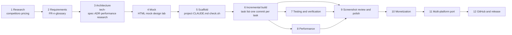

# 00 · Overview: from idea to store-ready

The process has 12 stages. Stages 1 through 5 produce only documents and mocks, never product code; from stage 6 on, every task lands as one commit. Each stage ends with "Done when" criteria, listed at the end of its Skill. If an output is missing or a check fails, you don't move on.



In practice, stages 6–10 form a loop: build a batch of tasks, take milestone screenshots, review them for P0/P1 issues, and add the fixes to the task list. Stage 11 (the other platform) can start any time after the first platform stabilizes. It repeats stages 2–9 but reuses the requirements as is.

## Stages and Skills

Each Skill is the source of truth for how to run its stage and what "done" means. The docs here cover only the background: why we work this way, and what went wrong along the way.

| # | Stage | Skill | Background |
|---|---|---|---|
| 1 | Research | `app-research` | [01](01-idea-and-research.md) |
| 2 | Requirements | `app-spec` | [02](02-requirements.md) |
| 3 | Architecture | `app-spec` | [03](03-architecture.md) |
| 4 | Mock | `app-spec`; for the design lab, see the background doc | [04](04-design-and-mock.md) |
| 5 | Scaffold | `app-scaffold` | [05](05-scaffold-and-guardrails.md) |
| 6 | Implementation | `app-task-loop` | [06](06-implementation-loop.md) |
| 7 | Verification | `app-task-loop` | [07](07-testing-and-verification.md) |
| 8 | Performance | No dedicated Skill; design and measure per the background doc | [08](08-performance.md) |
| 9 | Polish | `app-screenshot-review` | [09](09-ui-review-and-polish.md) |
| 10 | Monetization | No dedicated Skill; the rules live in ADRs | [10](10-monetization.md) |
| 11 | Multi-platform | `app-platform-port` | [11](11-cross-platform-port.md) |
| 12 | Release | `app-repo-publish` | [12](12-github-and-release.md) |

[13-lessons-learned.md](13-lessons-learned.md) collects the pitfalls we actually hit.

## How the documents reference each other

```text
feature-requirements.md (FR-n) ──┬─▶ tech-spec.md (which FRs each layer implements)
                                 ├─▶ dev-progress.md (each task tagged with its FR-n)
                                 ├─▶ commit messages / ADR / decisions.md
                                 └─▶ platform mapping table in the other platform's architecture.md
adr/ ──▶ "Hard rules" in CLAUDE.md (each ADR's "Red lines" are copied in, so the agent sees them every time)
CONTEXT.md ──▶ one vocabulary across code names, UI copy and docs
```

## Who does what: human vs. agent

| Human | agent |
|---|---|
| Supplies the idea, target users, platforms and red lines (what we won't do) | Researches competitors and pricing and writes it up with evidence |
| Reviews at every gate and makes the trade-off calls (picks an option in each ADR) | Drafts the requirements, architecture and ADRs, including the rejected options |
| Authorizes external actions: downloading SDKs, creating repos, pushing, test purchases | Implements, runs checks, reviews its own screenshots, logs decisions and problems |
| Signs off on the "not verified" items at the end (real devices, real purchases, interactions that need a tap) | Spells out what it couldn't do instead of pretending it's done |

## Suggested pace

- First platform: stages 1–5 take about a day, mostly human review of the research and requirements. Implementation then works through the task list, with a milestone every 3–5 tasks.
- Each later platform reuses the requirements and research and starts at stage 3. A port of around 20 tasks fits in one long session (with scheduled wake-ups to resume).
